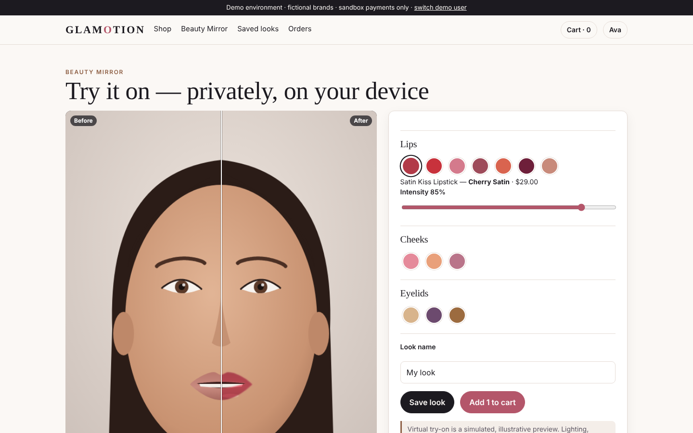

# GLAMOTION

Beauty storefront with private, on-device virtual try-on — plus a studio where brands and agencies turn the same products into approved motion campaigns.

**Status:** working vertical slice (demo mode), built from `docs/MASTER_SPEC.md`. See `backlog/status.md` for exactly what is done, partial and not started.

- Storefront, product pages with shade rail, server-priced cart, idempotent sandbox checkout, signed webhooks
- Beauty Mirror: consent gate, illustrated demo face / photo upload / live camera, lips·cheeks·eyelids overlay, before/after, saved look recipes
- Studio: catalog & inventory, briefs/projects, motion editor (8 templates, timeline, inspector, undo, 409-safe saves), client review links, render worker (real WebM)
- Runtime AI: gated product→campaign workflow with schema-validated agents, compliance rules, budgets and two human approval gates
- Supabase SQL with forced RLS on every table and two-tenant attack tests

Quick start: see [START_HERE.md](START_HERE.md). Repository rules: [CLAUDE.md](CLAUDE.md).
