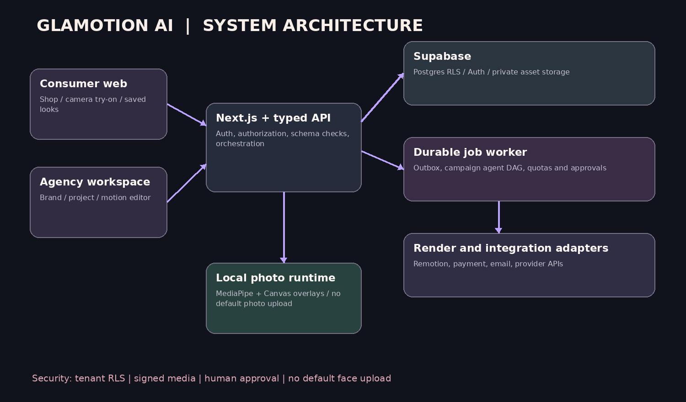
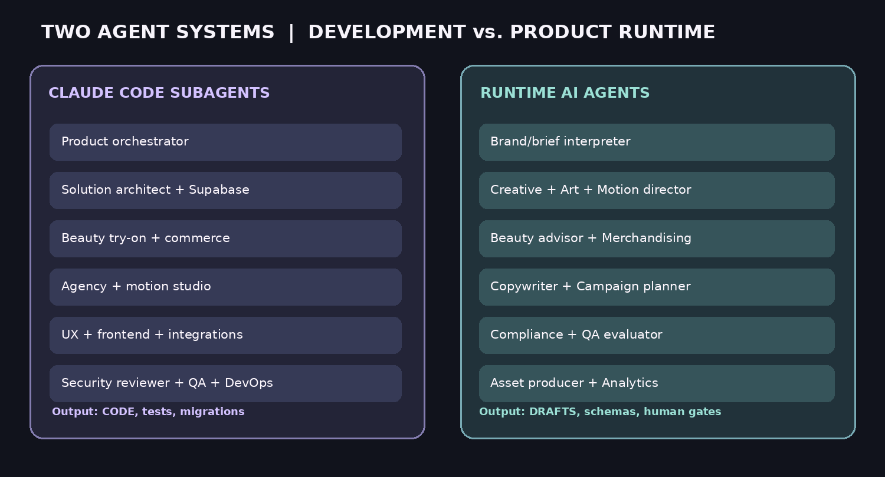
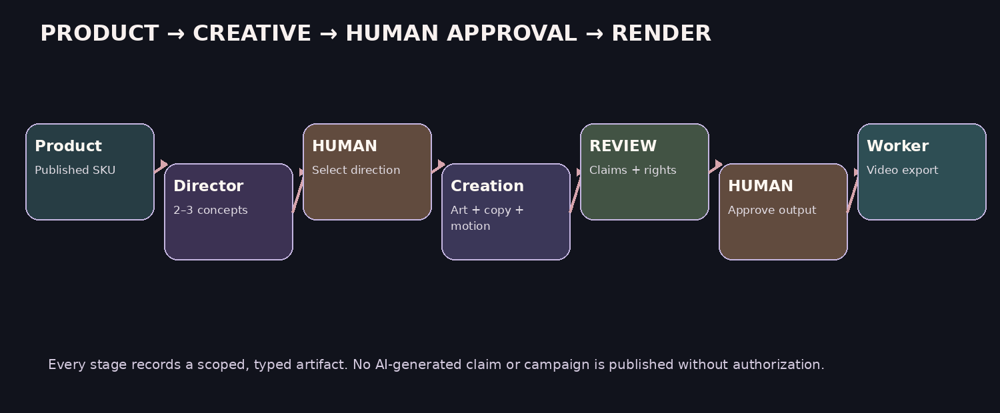

# GLAMOTION AI — Claude Code Master Spec v2.1 (converted from the supplied .docx)

Claude Code • Cosmetics Commerce • Virtual Try-On • Creative Agency •
Motion Studio

**VERSION 2.0 \| 17 NOVEMBER 2026**

Purpose: implementation-grade requirements, architecture, role
boundaries, workflow contracts, acceptance tests, and instructions for a
team of specialist development agents.

Companion deliverable: GLAMOTION_Claude_Code_Build_Kit.zip includes
Claude Code subagent definitions, runtime prompts, starter SQL
migrations, schemas, OpenAPI outline, and machine-readable backlog.

# How to use this package

-   Unzip the Build Kit to the root of your Claude Code project.

-   Read START_HERE.md, CLAUDE.md, docs/MASTER_SPEC.md and
    backlog/tasks.csv.

-   Use development agents in .claude/agents to implement modules;
    runtime_agents are application agent prompts, not development
    personas.

-   Build a small end-to-end slice first, and use hard security/privacy
    gates before production.

-   Every actual implementation claim requires code, test evidence and
    an integrated working demonstration.

**Critical: The SQL and TypeScript contracts are a starting foundation.
This deliverable is not a deployed product or a completed working web
app.**

# 01 \| Product mission, positioning, and delivery assumptions

GLAMOTION AI is a unified beauty-commerce and creative-production
platform with two connected products: a consumer beauty storefront with
virtual cosmetic try-on, and a B2B workspace for cosmetics brands and
creative agencies. The distinctive loop is: create product -\> attach
calibrated shades -\> preview makeup on a customer -\> convert to
purchase -\> understand outcomes -\> produce a campaign from the same
product and brand assets.

**North star**: a brand can onboard a SKU, let a shopper preview its
shade, and publish an approved product video without transferring assets
between disconnected tools.

**Primary customers**: (1) shoppers; (2) cosmetics brands and retailers;
(3) agency operators/designers/motion artists; (4) invited client
reviewers; (5) later, approved creators. This is NOT a dermatology
diagnostic tool, an identity recognition system, or a full After Effects
clone.

**Delivery assumption**: first release is a responsive web/PWA built on
Next.js + TypeScript, Supabase Postgres/Auth/Storage, Vercel for the web
tier, separate CPU/GPU/render workers for heavy jobs, and provider
adapters for payments and AI. English-first with architecture ready for
Arabic and Hebrew RTL. Supported regions, currencies, payment
processors, taxes, and shipping must be explicitly configured before
checkout is activated.

**Meaning of implementation-ready**: this package defines contracts,
file ownership, schemas, acceptance gates, build order, agents, and
reference code. It is a build specification and starter artifacts, not a
claim that a production application or commercially accurate virtual
try-on engine already exists.

**Success measures**: sign-up-to-try-on completion,
try-on-to-product-click, product-click-to-add-to-cart, checkout
conversion, design brief-to-first-draft duration, campaign approval
cycle, video render success, 95th-percentile preview latency, crash-free
sessions, deletion SLA adherence, and tenant boundary test pass rate.

# 02 \| Scope gates: MVP, Pro, and future

  -----------------------------------------------------------------------------
  **Capability**    **MVP / P0**           **Pro / P1**       **Later / P2**
  ----------------- ---------------------- ------------------ -----------------
  Beauty storefront Product lists,         Bundles,           Marketplace,
                    filters, PDP, shades,  recommendations,   multi-seller
                    cart, checkout         reviews            settlement

  Camera and photo  Consent, upload,       Better complexion  Live mobile
  try-on            webcam,                handling,          native AR and
                    lipstick/blush/eyes,   foundation         multi-person
                    compare, save          calibration,       modes
                                           robust face-pose   

  Agency operations Tenant workspace,      Contracts,         White-label and
                    brands, projects,      estimates,         partner APIs
                    briefs, boards,        billing, advanced  
                    approvals              utilization        

  Creative editor   Layered graphics,      Brand component    Collaborative
                    branded templates,     library, full      real-time design
                    image/text assets      scene graph        

  Motion            Templates, property    Graph editor,      Advanced 3D and
                    animation,             masks, audio,      high-end VFX
                    timeline-lite, export  reusable effects   
                    jobs                                      

  AI                Brand brief analysis,  Multi-step agent   Autonomous
                    campaign drafts, safe  workflows,         scheduling under
                    copy, human approval   iteration and A/B  enterprise
                                           assets             policies

  Marketing         Campaign drafts and    Connected          Cross-network
                    preview, manual        platforms and      optimization
                    publication            attribution        

  Analytics         First-party events,    Cohort/creative    Predictive
                    funnels, order/revenue analytics          forecasting
                    stats                                     
  -----------------------------------------------------------------------------

**Hard MVP cuts**: no medically framed skin analysis, biometric identity
matching, automatic posting or spending without approval, automated
refund decisions, influencer cash-out, tax jurisdiction engine, live
multiuser video editor, guaranteed shade matching, generative
modification of minors, or open-web scraping of people\'s accounts.

**Demo fixtures**: use clearly labeled fictional brands, sample
cosmetics and synthetic or licensed demo faces; no real consumer selfies
committed to source control.

# 03 \| Tenancy, identities, RBAC and security boundary

Tenancy follows organization_id; user accounts can belong to multiple
organizations. Every B2B resource is owned by exactly one organization.
Shopper-owned data is private to auth.uid() unless user explicitly
shares a published look. Product listings may be public when
status=published; unpublished stock, cost, drafts, contracts and
customer information remain tenant-private.

Roles: platform_admin (internal platform only), organization_owner,
organization_admin, brand_manager, creative_director, designer,
motion_designer, analyst, client_reviewer, shopper, creator (P1). Roles
are represented in membership records and server-authorized
capabilities, not trusting client-provided role names. All restricted
writes use RLS and/or verified server capability checks.

**Permission design**:

-   Product public read: only published product/shade/media in published
    organizations.

-   Catalog edits: brand_manager or organization admin/owner in owning
    organization.

-   Agency creative edits: design/motion/creative roles and admins;
    client_reviewer can read assigned project and comment/approve, not
    modify master files.

-   Financial records: administrators and billing-scoped operators;
    shoppers see their own orders.

-   Selfies: shopper alone via expiring storage paths; no access to
    tenant operators without explicit per-asset share. Never use public
    buckets for customer face media.

-   AI runs: scoped organization + invoking user; tool invocation checks
    the originating human permissions and provider allowlist.

-   Service-role credentials: worker/server only; never bundled into
    client, logs, or generated asset URLs.

**Membership checks** must be database-side and stable under concurrent
changes. Use helper functions with carefully set search_path and test
privilege escalation and RLS recursion. Never use convenience policies
like USING (true) on private tables.

# 04 \| Product information architecture and routes

  ----------------------------------------------------------------------------------
  **Area**                **Example routes**                 **Audience**
  ----------------------- ---------------------------------- -----------------------
  Storefront              /, /shop, /shop/\[slug\], /looks,  Public
                          /brands/\[slug\]                   

  Beauty Mirror           /try-on, /try-on/\[sessionId\],    Auth or guest session
                          /saved-looks                       with opt-in persistence

  Shopping                /cart, /checkout, /orders,         Shopper
                          /account                           

  Workspace               /studio/\[orgSlug\]/overview,      Organization members
                          /settings, /members                

  Catalog admin           /studio/\[orgSlug\]/products,      Brand operators
                          /products/new, /inventory          

  Creative                /studio/\[orgSlug\]/projects,      Agency creatives
                          /design/\[id\], /motion/\[id\]     

  Campaigns               /studio/\[orgSlug\]/campaigns,     Brand + agency
                          /agents, /content-calendar         

  Customer portal         /review/\[token\],                 Invited client reviewer
                          /review/\[token\]/version/\[id\]   

  Platform ops            /ops/audit, /ops/jobs, /ops/abuse  Internal only
  ----------------------------------------------------------------------------------

Responsive rules: desktop supports dense editing workspaces with docked
panels; mobile is consumer-first. Show a simplified on-mobile motion
preview instead of pretending a 4-panel editor is comfortable on narrow
screens. Routes use server auth guards plus data policies. Not-found
behavior must not disclose other tenants\' resource existence.

**App navigation**: public shopping and try-on navigation remain
separate from workspace navigation, while a role-aware switcher joins
them. Search, onboarding state, notification center, save indicators,
background job progress, optimistic error rollback and offline/photo
permissions all need explicit UI states.

# 05 \| Design system: luxury beauty meets motion

Identity recommendation: dark editorial surfaces + warm cosmetic
accents; a light beauty storefront and a high-contrast charcoal studio.
Design should use motion purposefully, not sacrifice accessibility or
performance.

**Tokens**: background #101016, surface #191922, ink #FAF7F3, accent
blush #E6A7B0, accent copper #BE8D70, highlight lavender #9C86EA, border
#34303A, success #4B9B79. Define semantic tokens rather than hardcoded
colors in components. Use a neutral UI family with optional editorial
display font; support Arabic/Hebrew fallback, line-height and text
expansion.

**Typography & spacing**: 4px scale; 8/12/16/24/32/48 card/container
spacing; 16px minimum interactive body text; contrast checked in both
themes. Support 320px mobile baseline and keyboard/touch interactions.
Reduced-motion mode disables elaborate transforms while retaining
essential feedback.

**Motion language**: subtle enter/exit transitions 160-300ms; campaigns
may use cinematic timelines but application chrome should not
continuously animate. Standardize curves, stagger tokens, feedback and
skeleton loading. Marketing videos autoplay muted only with proper user
settings, pause controls, bandwidth awareness.

**Key screens**: public landing with a moving brand hero; shoppable
beauty category; detailed product with shade rail and Try-On;
full-screen camera with consent controls and local processing status;
saved looks; agency home KPIs; brief intake; design canvas; motion
timeline; product-to-campaign wizard; client review room; agent run
graph and approvals; admin/security views.

**Component inventory**: AppShell, GlobalSearch, TenantSwitcher,
ProductCard, ShadeSwatch, MakeupRegionControls, CameraConsentGate,
TryOnCanvas, BeforeAfterSlider, SnapshotDrawer, AssetPicker,
BrandKitPalette, LayerTree, KeyframeTimeline, Scrubber,
PropertyInspector, RenderQueue, ApprovalPanel, AgentRunGraph,
InvoiceSummary, ConsentSettings.

# 06 \| Core user journeys and state transitions

**J1 shopper try-on -\> purchase**: browse published product -\> inspect
variant and price -\> select Try-On -\> explicit camera permission OR
image upload -\> detect a single face locally -\> display eligible
regions -\> overlay shade with adjustable opacity and finish -\> compare
with original -\> add specific SKU variant to cart -\> server validates
price, stock and checkout -\> receive order confirmation after provider
webhook. Canceling camera stops tracks. Guest session defaults to no
persistent face media.

**J2 returning customer**: opt into Saved Looks, receive a private
object path and look_recipe record -\> revisit account -\> change one
color/variant -\> see whether SKU is still available -\> add
alternatives to cart. Deleting account removes derived previews and
underlying uploaded photos within documented retention rules.

**J3 brand merchandiser**: create product -\> add variants and inventory
-\> upload licensed product assets -\> enter ingredients and claims with
approval -\> map cosmetic categories, finish and shade data -\> publish
-\> preview in beauty mirror -\> trigger draft campaign.

**J4 agency operator**: tenant setup -\> invite designer -\> intake
client brief -\> create project and source assets -\> choose brand kit
-\> generate design drafts -\> designer edits layered scenes -\> request
review -\> resolve timestamped comments -\> approve -\> render -\>
deliver asset URL and version history.

**J5 creative campaign**: product published -\> user selects campaign
objective + platform + locales -\> Creative Director agent writes
creative directions -\> Art Director/Motion Director draft structured
editable content -\> Compliance/QA validates copy and rights -\>
mandatory human approval -\> render background job -\> deliver
preview/export -\> optionally schedule connected publishing in P1 only
after explicit permission.

**J6 support & deletion**: a user can find privacy controls, revoke
saved-photo permission, delete look media, export account content where
applicable, and submit a deletion request; support cannot access face
media by default. Every deletion action has an audit event but should
not preserve the deleted face itself.

**State machines**: product draft -\> in_review -\> published -\>
archived; project intake -\> active -\> review -\> approved -\>
delivered -\> archived; render queued -\> running -\>
completed/failed/cancelled; order created -\> pending_payment -\> paid
-\> fulfilling -\> fulfilled OR cancelled/refunded; campaign brief -\>
proposals -\> editing -\> compliance_check -\> human_approval -\>
scheduled/published. Invalid transitions are rejected server-side.

# 07 \| Virtual try-on detailed engine

The critical differentiation is **real-time deterministic on-device
overlay** for core cosmetics, not a promise of perfect model-generated
photorealism. User-provided photos and camera pixels stay client-side by
default. MediaPipe Face Landmarker provides landmarks and pose
estimates; WebGL/Canvas layers paint makeup within region masks. A
separately enabled high-fidelity asynchronous image enhancement flow may
call an approved service only with explicit opt-in and retention
disclosure.

**Pipeline**: choose photo/camera -\> permission gate -\> EXIF
orientation & size validation -\> load model -\> single-face detection
-\> keypoint confidence check -\> normalized geometry -\> build
lip/cheek/eyelid regions (raster masks/triangles) -\> material renderer
with product shade, intensity, opacity, gloss/shine parameters -\>
compositing + edge feathering -\> save a recipe (product variant IDs +
parameters), with optional image persistence after opt-in.

**Performance approach**: main-thread UI + vision worker or offscreen
computation where supported, resolution scaling, frame throttling,
adaptive quality and deterministic cleanup of camera and GPU resources.
Client-side 2D lipstick/blush/eye effects P0; accurate foundation
texture and occlusion across head pose P1 after calibration validation.

**Error states**: no face, multiple faces, low light, strong occlusion,
camera permission denied, unsupported browser, landmark instability,
motion blur, model unavailable, GPU unavailable, portrait rotation,
disconnected device. In P0 multiple faces triggers \'choose
single-person image\' rather than risking wrong overlays.

**Color calibration**: products store brand-supplied sRGB/CIELAB
references, finish and opacity; preview is illustrative. Lighting,
camera color science and screens affect outcome. Never claim exact shade
match; include an honest and persistent preview disclaimer near purchase
CTA. Use customer-controlled intensity and render modes; do not infer
race/ethnicity or medical skin condition.

**Privacy**: do not log image pixels or face landmarks, no face
recognition, no biometric templates/identity matching, no training on
customer photos, no background uploads. Do not keep raw camera frames
after component unmount. Stored photo media is private, encrypted in
transit and at rest with authorization; allow user-initiated removal.
Treat photos of minors and photos of non-consenting people
conservatively; build clear policy and moderation at sharing boundaries.

**TryOnRecipe v1**: {version, sourceAssetId?,
selectedProducts:\[{productVariantId, cosmeticRegion, opacity, hueShift,
gloss}\], lightingPreset, crop, viewportTransform}. Keep rendering
engine reproducible with seeded inputs and versioned algorithms.

**Quality gates**: overlays respect lip corners during speaking/smile,
preserve teeth/eye whites, don\'t spill onto hair/background, no
cross-face bleed; 30 sample conditions across 6 skin reflectance ranges
and diverse lighting using rights-cleared images, acceptance after human
calibration review. Camera access tested on Android Chrome, iOS Safari,
desktop Chrome/Edge/Safari. Set actual device-specific FPS targets after
benchmarking; never overpromise 60 FPS.

# 08 \| Cosmetics catalog, variants, inventory and checkout

Data hierarchy: organization -\> brand -\> product -\> variant -\> shade
metadata + media + ingredient list + stock. One product may have
multiple finish/shade variants and multiple media assets. Source catalog
must keep product and variant stable IDs; campaign assets reference the
same IDs.

**Product detail view**: title, category, brand, price/currency,
available shade list, swatch and product photo, application
instructions, finish, ingredients, warnings, size, availability, try-on
CTA, reviews (P1), delivery/returns disclosure, linked looks,
accessibility descriptive text.

**Commerce invariants**: prices, discounts, stock and shipping cannot be
trusted from the browser; checkout line prices are computed on server at
confirmation. Inventory reservation uses transactional locking or atomic
reserve function; idempotency key prevents duplicate charges/orders.
Payment success determined by verified payment webhooks (not front-end
redirect). Webhook processing deduplicates event IDs. Refund/return
actions require business rules and audit records.

**Shipping/tax**: address validation, configurable shipping zones and
tax rules. Until a tax provider and legal region are selected, the
checkout integration must be gated behind feature flags. MVP can run
catalog + demo checkout without real orders. Currency uses ISO code and
integer minor units; tax inclusive/exclusive configurable per market.

**Safeguards**: prevent out-of-stock sale, negative available units,
duplicate SKU per organization, unpublished product purchases,
mismatched currency totals, client-side discount injection and applying
obsolete price after stale cart. Payment provider secrets only on
server; never store full payment card information.

**Order data**: immutable order line snapshots for product name, SKU,
unit price, tax, discounts and currency. Use order status ledger/event
log for traceability. Cart may exist anonymously but merge securely on
authentication. Emails are transactional and idempotent.

# 09 \| Agency project and client approval system

An agency tenant has accounts, client organizations (logical entities,
not universal auth tenants), projects, creative briefs, tasks, assigned
members, uploaded assets, versioned artwork, review sessions, comments,
approval decisions and delivery records.

**Brief intake**: project type, objective, audience, brand, channels,
required aspect ratios, deliverables, references, constraints, due
dates, legal claims, budget range and approver list. Generate an
editable summary; client must confirm factual claims. Track scope
changes and revision rounds.

**Project structure**: project -\> deliverables -\> artifact version -\>
comments, approval. All comments anchor to version, optionally
scene/timecode/element ID. New revisions do not erase context. A client
link is short-lived, scoped, revocable and cannot list other projects.

**Review rules**: team can upload a new draft; reviewers can add
annotations; only designated approvers can approve; approved asset
becomes immutable delivery version with checksum and signed export link.
Explicitly record actor/time/action. Client feedback does not mutate
source editor data in background.

**Commercial operations P1**: quotes, contract references, milestone
billing, time tracking and subscription retainers. Keep these away from
shopper commerce tables except shared organization/billing entities.
Invoice generation and tax handling are jurisdiction-specific
integrations requiring legal review.

# 10 \| Graphic design editor and composable document model

Editor P0 is a constrained professional design canvas for campaign
graphics and product compositions, NOT a generic freeform DTP engine.
Support text, shapes, uploaded images, products cutouts,
color/background fills, grouping, transforms, duplication, layer order,
alignment, grid/snapping, undo/redo, font selection, asset library and
templates.

**Authoritative document JSON**: version, width, height, background,
layers with stable IDs/types, transforms/visible/locked, text or image
references, parent IDs, z-index, style, brandkit version and provenance.
Validate with Zod before persistence. No direct untrusted HTML/CSS
injection in render content. Store immutable versions + current mutable
head through server revision sequence; conflict detection via
baseRevision and 409 response.

**Editor experience**: left asset/library panel, center canvas, right
inspector, top modes/save/preview/export, bottom timeline when motion is
opened. Keyboard shortcuts, accessible tooltips, history stack, autosave
with debounce, offline signal, proper loading/failed-save states. Mobile
view is browse/review only for complex editing.

**Image rights**: store ownership/source/license/expiry per asset. Do
not allow AI agent to assert rights that are missing; block publishing
if required license info is absent. Use signed media URLs for private
assets and transformations via trusted image pipeline.

# 11 \| Motion Design Studio and video rendering

Core shape: composition contains scenes; scene contains layered
elements; element may carry keyframed tracks for position, opacity,
rotation, scale, blur, color and crop. Store a versioned JSON timeline
independent of renderer implementation. Frame-accurate time uses
frames/fps, not floating time seconds; animation presets compile to
keyframes. Render Remotion compositions from validated JSON.

**P0 presets**: luxury product reveal, lipstick swipe, animated shade
lineup, before/after transition, logo reveal, kinetic typography,
seasonal promotion and 9:16 Reel composition. Each generated item
remains editable. Provide 1:1, 4:5, 9:16 and 16:9 aspect presets,
safe-area overlays and lower-third/title checks.

**Editor UI**: preview canvas, layer tree, timeline lanes, keyframe
controls, scrubbing, inspector, brand-asset picker, transitions,
undo/redo, render preflight and export status. Support accessibility
(reduced motion preview) even if rendered creative itself is
motion-heavy.

**Rendering**: user initiates export -\> API validates tenant access,
version, media references, quotas and payload size -\> transaction
creates render_jobs row and outbox event -\> worker claims job
idempotently -\> renders artifact in dedicated environment with
size/time caps -\> uploads private output -\> publishes time-limited
signed download -\> emits complete/fail event. Cancel stops work where
feasible; retries exponential backoff with terminal failed state and
human-readable error.

**Provider strategy**: use Remotion server renderer on dedicated worker
or managed rendering service (e.g., Lambda). Vercel serves UI/APIs, not
an assumed unlimited video encoder. Implement render adapter and
resource-based quotas, plus brand/provider usage ledger. CPU cost,
memory, licensing, codecs, music rights and commercial Remotion license
obligations must be verified before launch.

**Render safety**: prohibit uncontrolled URL fetches and remote asset
SSRF. Every element asset must resolve to an allowlisted, signed,
internal media object. Avoid shell interpolation. Sanitize text; cap
frame count, dimensions and asset size. Never embed keys in finished
videos.

# 12 \| Runtime AI multi-agent operating model

Runtime AI agents are **application services**, distinct from Claude
Code development subagents. All runtime agents are called by a server
workflow orchestrator, not by letting an LLM directly edit the database,
spend ad budget, charge customers, or publish campaigns. Agents accept
typed JSON input, return typed JSON/asset references, and operate under
human and tenant constraints.

**Agent catalog**:

  -----------------------------------------------------------------------
  **Agent**         **Inputs**        **Structured      **Approval gate**
                                      outputs**         
  ----------------- ----------------- ----------------- -----------------
  Brief Interpreter Brand brief,      requirements,     Human confirms
                    permitted assets  risks, missing    brief
                                      info              

  Creative Director Approved brief,   2-3 concepts,     Human selects
                    brand tokens      creative criteria direction

  Art Director      Concept + brand   scene layouts,    Designer review
                    kit               assets list       

  Motion Director   Scenes,           keyframe/scene    Designer review
                    channel/aspect    plan              

  Beauty Advisor    User-selected     suggestions with  User choice;
                    looks, product    product IDs +     never diagnosis
                    metadata          rationale         

  Merchandising     Product catalog,  bundles, product  Merchant
  Agent             availability      descriptions      publication
                                                        approval

  Copywriter        Product claims,   headlines,        Claim/legal
                    campaign brief    captions,         review
                                      variants          

  Compliance        Draft copy,       warnings,         Cannot replace
  Reviewer          rules, rights     block/allow       legal reviewer
                                      recommendation    

  Campaign Planner  Goal, platforms,  draft content     Explicit campaign
                    budget cap        calendar,         approval
                                      objectives        

  Asset Producer    Approved specs +  generated         Human preview
                    assets            image/video job   
                                      plan              

  QA Evaluator      Outputs + brief   checklist,        Gates release
                                      deviations,       
                                      confidence        

  Analytics         Aggregated event  insights,         No direct spend
  Interpreter       data              hypotheses        modifications
  -----------------------------------------------------------------------

**Control plane**: persistent \`ai_workflows\`, \`ai_steps\`,
\`agent_runs\`, \`agent_artifacts\`, \`human_approvals\`,
\`model_usage\` and \`audit_events\` with correlation IDs. Use DAGs /
finite-state workflows with explicit replay/retry; no recursive
autonomous loops without hard budgets and stop conditions. Agents have
versioned prompts, schema validation, per-tenant rate limits and
deterministic tool allowlists.

**Policy**: log prompt metadata and redacted outputs, not customer
selfies or provider credentials. Avoid sending raw faces into text agent
prompts. Mark model-generated suggestions as suggestions, not facts.
Human must approve public campaigns, health-like claims, spending or
posting. Users can refuse AI processing when core manual flow supports
it.

# 13 \| Runtime workflows and failure routing

**WF-01 Product-to-campaign**: Brand publishes SKU -\> Brief Interpreter
extracts verified claims + required assets -\> Creative Director
proposes directions -\> \[HUMAN SELECTS\] -\> Art Director proposes
scene documents -\> Copywriter proposes safe text -\> Motion Director
composes keyframes -\> Compliance + QA independent checks -\> \[HUMAN
APPROVES\] -\> render job -\> preview/export. Rejections go to editor
revision with retained audit trail, not automatic indefinite
re-generation.

**WF-02 Guided Beauty Look**: shopper voluntarily selects occasion/style
and desired product categories -\> Beauty Advisor queries in-stock
products with safe metadata -\> produces 3 looks (no claims about race,
gender, medical status) -\> shopper chooses look -\> virtual try-on
engine applies deterministic visual overlays -\> wishlist/cart. Agent
never sees or stores full face photo by default.

**WF-03 Agency Brief-to-Delivery**: brief -\> concept suggestion -\>
project task creation -\> human work -\> version upload -\> client
review -\> approval -\> render/export -\> delivery. AI supports drafts
but approval is owned by authorized human.

**WF-04 Content localization**: approved source creative -\> Copywriter
drafts English, Arabic, Hebrew text -\> language-quality review -\>
layout/font expansion and RTL checks -\> humans approve regional claims
-\> export.

**WF-05 Product availability event**: inventory update -\> invalidate
stale cart pricing and recommendations -\> agent-generated bundles
rerank only published, in-stock variants; it cannot change prices
autonomously.

**Failure model**: each step has deadline, max retries (default 2 with
exponential jitter), input/output hashes, error category,
\`needs_human\` escalation, and compensation. Any rejected or
schema-invalid AI result goes to a safe failed/needs_review state, never
public release. Idempotency keys prevent duplicate artifact generations.

**State flow**: proposed -\> queued -\> running -\> awaiting_human -\>
running -\> completed / failed / cancelled. Parent workflow aggregates
child states; audit every transition. Usage ledger records tokens,
render seconds and estimated cost by organization, without leaking PII.

# 14 \| Development-time Claude Code multi-agent team

These are **Claude Code project subagents**, files in
\`.claude/agents/\*.md\`, invoked for focused engineering work. They are
NOT production agents and have no runtime access to customer photos.
Root \`CLAUDE.md\` holds universal repository rules; subagent files
encode role-specific objectives; \`docs/\` hold detailed domain
contracts.

  -----------------------------------------------------------------------------
  **Agent**                     **Primary ownership**   **Required handoff**
  ----------------------------- ----------------------- -----------------------
  product-orchestrator          Tasks, architecture     Decision log + merged
                                gates, integration      milestone report
                                order                   

  solution-architect            Bounded contexts,       ADRs and integration
                                contracts, technical    constraints
                                decisions               

  ux-design-system              Tokens, usability,      Storybook/UI tests
                                screens, accessibility  

  frontend-engineer             Public/shopper and      Route tests +
                                workspace React UI      screenshots

  supabase-data-engineer        SQL schema, RLS,        Migration tests + ERD
                                indexes, migrations     

  beauty-tryon-engineer         Camera, landmarks,      Device/visual QA
                                overlay renderer        results

  cosmetics-commerce-engineer   Catalog, cart,          Payment/idempotency
                                checkout, webhook       tests
                                safety                  

  agency-workflow-engineer      Projects, briefs,       Permission and state
                                reviewer/approval flows tests

  motion-studio-engineer        Scene JSON, editor,     Frame/render test
                                Remotion exports        fixture

  ai-workflow-engineer          Runtime agents,         Schema and escalation
                                prompts, policies, DAG  tests

  integrations-engineer         Media providers,        Sandbox adapter tests
                                emails, payment         
                                adapters                

  security-privacy-reviewer     Read-only threat model, Severity findings and
                                RLS audit, privacy      remediation

  qa-test-engineer              E2E, accessibility,     Release verification
                                load, test data         report

  devops-release-engineer       Vercel, worker, CI,     Deploy runbook,
                                secrets, monitoring     recovery drill
  -----------------------------------------------------------------------------

**Parallel work policy**: agents may independently research and
implement disjoint directory areas. Owner of a shared interface/SQL
migration must finalize contract before another agent consumes it. No
parallel editing of the same files or \`package.json\` without
orchestrator serializing merges. For risky parallel implementation use
isolated git worktrees and verify changes before integration.

**Handoff format**: ticket ID; intent; changed files; commands executed;
test results; migrations; security/privacy implications; unresolved
questions; dependent ticket IDs. No agent may report \'done\' without an
executable verification or explicit explanation of missing
prerequisites.

# 15 \| Monorepo, boundaries and build conventions

glamotion/

CLAUDE.md

.claude/agents/\*.md

.claude/skills/\*/SKILL.md

apps/web/ \# Next.js App Router public + B2B UI/API

apps/worker/ \# background workflow and render dispatch

packages/ui/ \# semantic tokens + accessible components

packages/contracts/ \# Zod/TS schemas + typed API objects

packages/tryon/ \# client landmarks, region maps, compositing

packages/motion/ \# scene model, templates, Remotion bridge

packages/agents/ \# runtime policy, prompts, orchestration

packages/core/ \# shared domain utilities and errors

supabase/migrations/ \# reviewed, immutable SQL migrations

tests/ \# integration, e2e, fixtures, visual

docs/ \# specs, ADRs, domain models, runbooks

**Code standards**: strict TypeScript; validation at all external
boundaries; no \`any\` in new public domain contracts; named errors; RFC
7807-like API error object; server-side money arithmetic as integer
minor units; date/time UTC with locale format in display; all internal
IDs UUIDs; server-generated DB timestamps.

**Architecture style**: modular monolith first with explicit interfaces
and background worker. Avoid premature distributed microservices.
Separate UI components, domain services, repository access, integrations
adapters and policies. Repository access never bypasses tenant scoping.
Tests cover invariant behavior, not implementation trivia.

**Dependencies**: use pinned compatible releases and verify current API
documentation during implementation. Do not blindly install latest major
of Next.js, React, Supabase SSR, MediaPipe or Remotion without a smoke
test. \`@supabase/ssr\` integration requires deliberate cookie/session
setup and authorization checks on sensitive operations.

# 16 \| Data architecture and entity catalog

**Identity & tenants**: profiles, organizations, organization_members,
org_invitations, client_accounts, brand_kits, audit_events. **Catalog &
commerce**: brands, products, product_variants, product_media,
inventories, inventory_movements, carts, cart_items, checkout_sessions,
orders, order_items, payment_events, shipping_addresses, discount_codes.
**Beauty**: tryon_sessions (ephemeral), looks, look_items,
private_assets, photo_consents. **Creative/agency**: projects,
project_members, briefs, design_documents, design_versions,
motion_compositions, scene_versions, review_sessions, annotations,
approvals, deliveries, asset_licenses. **AI & operations**: campaigns,
campaign_assets, ai_workflows, agent_runs, agent_artifacts,
human_approvals, job_outbox, render_jobs, usage_ledger,
analytics_events.

**Foreign-key rule**: all tenant-owned rows carry organization_id or
have an approved composite parent reference; do not rely on client joins
to enforce security. Attach unique constraints for (organization_id,
SKU) and one active membership per user/org. Use composite indexes for
status + created_at on high-volume queues, order index by shopper_id and
org. Partition event tables when volume demands it, not prematurely.

**Private media design**: \`private_assets\` metadata contains
tenant/user scope, bucket/key, content hash, MIME type, size, retention,
consent grant and encryption/key metadata if applicable. Supabase
private bucket RLS enforces folder ownership; signed links only issued
by server after authorization and kept short-lived. Separate product
public media from photo private media.

**Data retention defaults (policy proposals, legal review required)**:
live camera frame = ephemeral memory only; guest photo = never uploaded;
opted-in uploaded photo = until user deletes or agreed retention expiry;
AI prompts = redacted metadata where feasible; job debugging logs =
short retention; financial order records = regulated retention
configured per market. Policy text and actual infrastructure deletion
must match.

# 17 \| Database migration sequence and RLS contract

Packaged SQL files provide a **P0 foundation** for identity,
brand/catalog, projects, looks, creative documents, workflow jobs and
auditing. Remaining catalog/financial expansion tables are explicitly
planned in \`docs/DATA_MODEL.md\` and implementation backlog; do not
assume all P1 tables exist in the migration.

**Migration sequence**: 0001_core.sql creates
extensions/functions/enums/tables/check constraints and indexes;
0002_rls.sql enables RLS and policies; 0003_jobs.sql adds outbox/job
helper logic. Apply through Supabase CLI in a migration-controlled
environment, never by manually editing production schema.

**Threat checks**: shopper A cannot view shopper B photo/look/order; org
A editor cannot view or modify org B draft, membership, render,
workflow; client reviewer token cannot enumerate project list; anonymous
session cannot query private faces; stale membership revocation takes
effect; service-role worker context validates job tenant provenance
before privileged action.

**Audit**: security-relevant actions include auth-sensitive changes,
publication, price change, refunds, approval, asset sharing, role
assignment, AI publish requests, data deletion and provider webhooks.
The audit table must not contain photo bytes, payment card data,
secrets, or raw model prompts.

# 18 \| API contracts and idempotency

API is versioned under \`/api/v1\`. Use route handlers for simple web
requests; worker job consumers for heavy operations. Every mutating
route validates request JSON with Zod, authenticates current user,
enforces permissions, and accepts trace identifiers. Sensitive actions
such as checkout and render creation use \`Idempotency-Key\` and a
unique DB key scoped to tenant or customer.

**Priority endpoints**:

  ------------------------------------------------------------------------------------
  **Method**              **Path**                             **Summary**
  ----------------------- ------------------------------------ -----------------------
  GET                     /api/v1/products                     Published/searchable
                                                               products

  GET                     /api/v1/products/{id}                Public PDP incl.
                                                               variants

  POST                    /api/v1/orgs/{orgId}/products        Create draft product

  PATCH                   /api/v1/orgs/{orgId}/products/{id}   Update draft and
                                                               validations

  POST                    /api/v1/tryon/sessions               Initialize
                                                               ephemeral/private
                                                               try-on metadata

  POST                    /api/v1/looks                        Persist opted-in look
                                                               recipe

  DELETE                  /api/v1/looks/{id}                   Remove owner look and
                                                               linked preview

  POST                    /api/v1/cart/items                   Server-verified variant
                                                               cart add

  POST                    /api/v1/checkout                     Create checkout session
                                                               from cart

  POST                    /api/v1/webhooks/payments            Verify provider
                                                               signature; dedupe

  POST                    /api/v1/orgs/{orgId}/projects        Create agency project

  POST                    /api/v1/projects/{id}/reviews        Request client review

  POST                    /api/v1/reviews/{token}/approvals    Record authorized
                                                               approval

  POST                    /api/v1/orgs/{orgId}/campaigns       Create campaign draft

  POST                    /api/v1/workflows/{id}/approve       Resume gated AI
                                                               workflow

  POST                    /api/v1/renders                      Validate and enqueue
                                                               render

  GET                     /api/v1/renders/{id}                 Status and signed
                                                               result when done
  ------------------------------------------------------------------------------------

**Example error**: \`{ \"error\": { \"code\": \"PRODUCT_UNAVAILABLE\",
\"message\": \"Variant no longer available\", \"requestId\": \"\...\",
\"details\": {} } }\`. Never leak table names, stack traces, object keys
or cross-tenant IDs.

**Domain events**: \`product.published.v1\`, \`look.saved.v1\`,
\`checkout.paid.v1\`, \`creative.approved.v1\`,
\`campaign.approval_requested.v1\`, \`render.queued.v1\`,
\`render.completed.v1\`, \`privacy.delete_requested.v1\`. Each event
includes eventId, timestamp, actor, org scope, entity IDs and
correlationId, never raw camera pixels.

# 19 \| Media, uploads, AI providers and integrations

Use signed upload grants, content-type allowlists, content length caps,
virus/malware scan where supported, verified media re-encoding, image
dimensions/format normalization and EXIF stripping. Keep original
immutable private asset + optionally generated previews with provenance.
Product images require licensing metadata. Customer photos are a
separate privacy class with stricter permissions and deletion.

**Provider adapters**: PaymentProvider (createCheckout, verifyWebhook,
refund), MediaStorage (issueUpload, signDownload, delete),
ImageGenerationProvider (generate with safety policies),
LanguageModelProvider (structured completion), RenderProvider (submit,
status, cancel), EmailProvider (transactional), AnalyticsSink (approved
first-party events), SocialPublisher (P1 explicit approval).
Fake/sandbox providers must exist for local tests.

**Quota accounting**: track LLM tokens, generated images, video seconds,
storage bytes and active jobs. Admin-configured hard limits stop
excessive billing. Every provider request carries a stable requestId,
tenantId and usage attribution and returns typed errors; retries never
duplicate external payments.

**Operational fallback**: where AI or generation is unavailable, users
can manually build from template; where camera unsupported, upload a
photo; where renderer fails, provide static export where possible and an
actionable message. No provider should be a single-point failure for
viewing already completed projects or orders.

# 20 \| Privacy, safety, trust and compliance by design

For face-based virtual makeup, use explicit transparent disclosures and
user choice. Rendering should happen on device for the baseline
experience. Avoid features that infer sensitive traits (race, health,
gender, age) from appearance; do not use face images for authentication
or identity matching. Do not route personal face data to unrelated AI
agents. Label try-on as simulated/illustrative and do not promise color
accuracy or medical skin improvements.

**Consent controls**: request camera permission only on action; explain
on-device vs cloud option, opt-in persistence and separate social
sharing. Camera stops upon close/background/route change. Declined
storage consent retains ephemeral functionality. Consent records are
versioned, revocable and auditable without storing unnecessary photo
data.

**Data rights**: request personal data export/deletion, unlink social
accounts, revoke shared links, delete saved looks and photos, monitor
pending deletion jobs. Retention strategy must cover storage objects,
derived previews, cache, CDN, backup schedule and downstream processors.
Don\'t claim instant deletion of immutable backups; explain actual
windows.

**Policy**: prohibit non-consensual intimate transformations, harmful
deception, discriminatory beauty scoring and unverified medical claims.
Screen public user-generated look shares and promotional copy for brand
safety. For children, enforce documented minimum age and jurisdiction
rules; MVP targets adults and must not solicit children\'s face photos.
Implement legal review of regional privacy, commerce and advertising
laws before go-live.

**Security baseline**: CSP, CSRF defenses where applicable, same-site
secure cookies, strict input validation, rate limiting and abuse
detection, webhook signature validation, immutable audit, secret
scanning, SAST/dependency scans, RLS cross-tenant integration tests,
signed URL expiry, SSRF allowlists, least privilege service accounts,
provider key rotation and incident response.

# 21 \| Analytics, experiments and observability

Primary events: \`product_view\`, \`shade_selected\`, \`tryon_started\`,
\`tryon_effect_applied\`, \`look_saved\`, \`cart_added\`,
\`checkout_started\`, \`purchase_completed\`, \`brief_submitted\`,
\`concept_generated\`, \`asset_approved\`, \`render_started\`,
\`render_completed\`, \`export_downloaded\`. Event payloads contain
coarse operational metadata and non-sensitive IDs only; no face
landmarks, RGB skin readings, raw selfies, or private prompt payloads.

**Dashboards**: consumer funnel by category and device; brand GMV/order
conversion; agency project cycle time and approval bottlenecks; agent
latency and token costs; rendering queue depth/success/failure; privacy
delete queue; security deny counts. Use opt-in analytics/consent when
legally required.

**SLO proposals** (benchmark and adjust): API 99.9% availability monthly
for core checkout/control endpoints, 99% job completion within the
configured deadline for under-limit exports, job status freshness \<15
seconds typical, 100% tenant boundary tests pass, zero P0 security
findings. P95 latency baselines are to be measured on representative
devices and networks before commitments.

**Reliability**: structured logs with requestId/orgId where allowed;
error monitoring with redaction; distributed traces across web and
worker; queue dead-letter and replay admin flow; database point-in-time
recovery and restore drill; asset retention alerts; automated rollback
triggers for checkout/permission regressions.

# 22 \| Testing strategy and acceptance matrix

**Unit tests**: pure pricing arithmetic; schema validation; permission
guard; order/project state transitions; overlay geometry transforms;
brandkit renderer; scene interpolation; prompt output parser; workflow
stopping conditions.

**Integration tests**: Supabase RLS with actor A/B identities; signed
asset controls; inventory reservation concurrency; payment webhook
deduplication; outbox enqueue and retry; role revocation; workflow
approval resumes; order amount snapshots.

**E2E tests** (Playwright preferred): shopper browse -\> try-on from
demo photo -\> look change -\> add to cart -\> sandbox checkout;
merchant onboarding -\> product publish -\> PDP; agency brief -\> draft
-\> comment -\> approve -\> render completion; camera permission denied
-\> upload fallback; customer delete -\> removed saved photo; forbidden
tenant access returns 403/404 with no data leak.

**Visual and device testing**: photo effects across poses/skin
reflectance/lighting with rights-cleared fixtures; mobile viewport
320-1440px; Safari/Chrome/Edge; AR/HE/EN layout; reduced motion,
keyboard and screen reader; motion frame snapshots of deterministic test
composition.

**Performance**: simulate load for catalog read, checkout idempotency
race, 100 queued small renders under bounded workers, 500 AI requests
denied by quotas correctly; verify UI remains responsive and no photo
buffers leak when camera sessions are restarted repeatedly.

**Release must fail** on unreviewed migrations, missing RLS policy,
leaked service-role key, payment webhook invalid signature acceptance,
cross-tenant read, unconsented selfie upload, campaign auto-publication
without approval, render SSRF, or known P0/P1 issue. Acceptance evidence
saved per sprint.

# 23 \| Build phases, epics and dependency gates

**Phase 0 --- Groundwork**: monorepo, CI, environment, ADRs, design
tokens, Supabase project, migrations, RLS tests, fake provider adapters
and example data. Gate: auth and tenant controls demonstrably secure.

**Phase 1 --- Shopper and catalog**: public storefront, merchant
catalog, variant SKUs, stock, product page, auth, camera/upload
permission UX, deterministic lipstick/blush/eyeshadow overlay and look
recipe persistence. Gate: cross-device smoke and facial privacy tests.

**Phase 2 --- Transactional commerce**: server-priced cart, inventory
reservation, sandbox checkout/webhooks, order view, shipping/tax
configuration gate, refunds workflow placeholder. Gate:
idempotency/concurrency/webhook security tests.

**Phase 3 --- Agency + creative**: organization/member onboarding, brand
kits, project briefs, layered graphics editor, version history, client
review and approval. Gate: tenant scoped files and review state tested.

**Phase 4 --- Motion**: scene schema, timeline-lite editor, Remotion
template, render worker, queue, signed downloads and quotas. Gate:
deterministic renders and retry/cancel tests.

**Phase 5 --- Runtime AI**: prompt registry, structured output, provider
adapters, gated multi-agent workflows, usage limits, campaign wizard and
QA review. Gate: human approval enforced and simulated adversarial
prompts fail safely.

**Phase 6 --- Hardening**: localization/RTL, accessibility, feature
flags, analytics, incident drill, backup restore, product claims legal
review, load tests and privacy policies. Gate: launch checklist fully
evidenced.

**Dependency sequence**: auth/tenancy -\> catalog -\> media privacy -\>
try-on; auth/tenancy -\> commerce; org/project -\> editor doc -\> motion
-\> render worker; brandkit/catalog/editor -\> AI campaign workflows.
Tasks may run in parallel only after shared schema interfaces are
accepted.

# 24 \| Detailed backlog and traceable acceptance

The canonical machine-readable backlog is \`backlog/tasks.csv\`, with
tickets categorized P0/P1/P2, owners, dependencies and executable
acceptance conditions. Every ticket PR links an artifact, migration/test
path and status. Development agents must not silently expand P0 scope to
implement a costly P2 feature.

**Mandatory premerge checklist**: typecheck, linter, unit/integration
affected tests, documented environment change, migration rollback
strategy, RLS tests for private tables, full API schema validation,
accessibility spot check, error handling and structured logging, no
secrets or real selfie fixtures.

**Integration contract review**: SQL field names must match TS types;
API payload Zod must match OpenAPI; render scene version matches
compositional types; product variant ID is canonical in try-on recipes,
cart/order and campaign asset references; workflows include approval
gate IDs; role matrix tests remain current.

**Definition of done**: code committed, tests green, relevant docs
updated, runtime/config assumptions clear, observability present,
security/performance consequences stated, direct owner signoff and
unblocked next task. Agent output alone does not constitute evidence of
completion.

# 25 \| Operational readiness, launch checklist and decisions

**Pre-production**: configure production Supabase with RLS audited and
PITR/backup; Vercel env protected; dedicated worker with queue, resource
cap and retry handling; CDN and signed URLs; provider keys; payment
sandbox then production go/no-go; allowed
jurisdictions/currencies/taxes/shipping; transactional email domain;
privacy policy & terms; copyright licenses; incident escalation; support
email, user deletion flow and request logging redaction.

**Launch gate**: 0 critical security issues; all tenant RLS tests
passing; checkout amount independent of front end; webcam consent and
cleanup validated; 20+ curated try-on samples approved visually;
campaign output human-approved; video render job reconciliation tested;
i18n critical screens validated; analytics without face pixels; 1
complete customer purchase and 1 complete agency project in staging.

**Open product decisions**: countries/currencies/shipping partners;
actual cosmetics inventory and licensed assets; payment vendor; cloud
high-fidelity try-on optional provider; preferred brand name and domain;
initial organization billing; customer consent/legal text and age
threshold; default locale; video output specs/budget. These are
configuration choices, not reasons to stall building the safe scaffold.

**Recommended first vertical slice**: merchant publishes one lipstick
shade -\> shopper opens product page -\> uploads sample photo locally
-\> changes lipstick opacity and sees before/after -\> adds variant to
cart -\> sandbox order -\> merchant converts product into 9:16 motion
template -\> human approves -\> render job finishes. This exercises the
product\'s unique value loop from end to end.

# 26 \| Claude Code master execution instructions

Place this kit into a new repository and start Claude Code from that
repository root. The root \`CLAUDE.md\` sets repository rules and points
to the spec; \`.claude/agents\` defines role-specialized subagents;
\`prompts/START_IN_CLAUDE_CODE.md\` contains the kickoff prompt.

**Do not ask the coding agent to create the entire product in one
context window.** Ask it to (1) read specs; (2) produce an ADR for
unresolved decisions; (3) define milestone contracts; (4) create
migrations and tenant tests; (5) implement a vertical slice with tests;
(6) delegate directory-owned changes; (7) integrate and report remaining
work. Allow parallel investigation, not parallel uncontrolled migration
edits.

**First terminal session command**: \`claude\` in the extracted
repository root; then paste \`prompts/START_IN_CLAUDE_CODE.md\`. If the
CLI supports named subagents, you can ask explicitly: \'Delegate this
work to the solution-architect and supabase-data-engineer; use
security-privacy-reviewer for read-only review.\' Names and descriptions
follow project agent files.

**Implementation discipline**: no external API calls with fake keys, no
guessing on current vendor APIs, no bypassing RLS to make tests pass, no
unapproved AI image sharing, no fabricated tests/results. Prefer stubs
with explicit \`NOT_IMPLEMENTED\` and work tickets over deceptive mock
production flows.

**Each sprint report**: completed ticket IDs, files,
screenshots/artifact evidence, tests run + pass/fail, current blocker,
next tickets, risks. Maintain \`docs/DECISIONS.md\` and
\`backlog/status.md\` as the system of record.

# Appendix A \| Developer agents

Complete per-agent YAML-frontmatter configurations and prompts are in
the ZIP under .claude/agents. The table below is a quick owner
reference.

  ----------------------------------------------------------------------------------------
  **Agent**                     **Workstream**                    **Acceptance focus**
  ----------------------------- --------------------------------- ------------------------
  product-orchestrator          docs/, backlog/, integration      Review integration
                                orchestration                     tests, tenant RLS tests,
                                                                  business/privacy gates;
                                                                  halt work on unresolved
                                                                  P0 risk.

  solution-architect            docs/ADR\*, packages/contracts/,  Prove one vertical slice
                                shared architecture interfaces    can cross domains safely
                                                                  without circular
                                                                  imports.

  ux-design-system              packages/ui/, docs/design/,       Keyboard/contrast/ARIA
                                component stories                 and 320px viewport
                                                                  tests; design
                                                                  consistency.

  frontend-engineer             apps/web/app/,                    No silent network
                                apps/web/components/              failures or permission
                                                                  leaks; browser privacy
                                                                  and layout tests.

  supabase-data-engineer        supabase/migrations/,             Demonstrate two-tenant
                                packages/core/db/                 attack tests, user-owned
                                                                  photos and no
                                                                  service-role in browser.

  beauty-tryon-engineer         packages/tryon/,                  No spill onto teeth or
                                apps/web/app/(shop)/try-on/       other regions;
                                                                  privacy/camera cleanup
                                                                  verified.

  cosmetics-commerce-engineer   apps/web/app/api/v1/checkout,     No price tampering,
                                packages/core/commerce/           oversell, duplicate
                                                                  payment/order, or data
                                                                  cross-tenant.

  agency-workflow-engineer      packages/core/agency/,            Client review links
                                apps/web/app/(studio)/projects/   cannot enumerate or
                                                                  mutate unrelated tenant
                                                                  content.

  motion-studio-engineer        packages/motion/,                 Deterministic frame
                                apps/worker/render/,              snapshots, safe resource
                                apps/web/app/(studio)/motion/     caps and cancel/retry.

  ai-workflow-engineer          packages/agents/,                 Prompt-injection tests,
                                runtime_agents/, apps/worker/ai/  budget stop, no
                                                                  premature publication.

  integrations-engineer         packages/integrations/,           External errors safe and
                                apps/worker/providers/            retryable without
                                                                  duplicate side effects.

  security-privacy-reviewer     All repositories (read-only)      Prioritize tenant
                                                                  leakage, selfies,
                                                                  service secrets, claims,
                                                                  payments and campaign
                                                                  approval.

  qa-test-engineer              tests/, qa evidence, fixtures     Never mark an unrun test
                                                                  as passed.

  devops-release-engineer       infra/, apps/worker/config/,      Never print credentials;
                                .github/workflows/                validate queue
                                                                  durability, job retries
                                                                  and database restore.
  ----------------------------------------------------------------------------------------

# Appendix B \| Delivery backlog summary

The companion ZIP contains 77 dependency-linked tasks in
backlog/tasks.csv. This appendix gives the counts and mandatory gates.

  -----------------------------------------------------------------------
  **Epic**          **P0**            **P1**            **P2**
  ----------------- ----------------- ----------------- -----------------
  Foundation        12                0                 0

  Cosmetics &       10                2                 1
  Commerce                                              

  Virtual Try-On    9                 1                 1

  Agency & Review   6                 1                 0

  Design & Motion   9                 1                 0

  Runtime AI &      9                 3                 0
  Campaigns                                             

  Operations,       9                 2                 1
  Privacy & Release                                     
  -----------------------------------------------------------------------

The ticket-level pass/fail conditions and dependencies are authoritative
in CSV. All begin TODO; a task is complete only after its code, tests,
review, and acceptance evidence exist.

# Appendix C \| Official technical reference points

-   Claude Code subagents: https://code.claude.com/docs/en/sub-agents

-   Claude Code steering/skills:
    https://claude.com/resources/articles/steering-claude-code-skills-hooks-rules-subagents-and-more

-   MediaPipe face landmarks:
    https://developers.google.com/edge/mediapipe/solutions/vision/face_landmarker/web_js

-   Supabase server-side auth:
    https://supabase.com/docs/guides/auth/server-side

-   Remotion rendering: https://www.remotion.dev/docs/render

-   Remotion SSR options: https://www.remotion.dev/docs/ssr

# Appendix D \| Suggested first-session deliverables

**A. Validate the repository:** Open START_HERE.md and CLAUDE.md.
Confirm there is no application implementation yet. List env keys
required, external accounts and mocked providers.

**B. Freeze security and domain contracts:** Run local Supabase
migrations in a test project, seed two organizations and two shoppers,
test cross-tenant denies, and generate Zod/TypeScript types.

**C. Build first vertical slice:** Publish one lipstick SKU, simulate
makeup on a client-local photo, save a non-biometric recipe, add to a
server-authoritative cart and use a sandbox checkout.

**D. Build creative reuse:** Open the product in a brand project, create
an editable 9:16 campaign scene, enqueue a bounded render, approve the
preview and download a signed video.

**E. Show actual evidence:** Return test commands, migration outputs,
screenshots, blocker list and a status report. Never mark features
complete based only on generated files.
